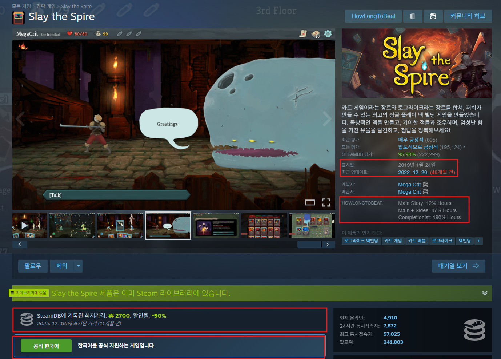
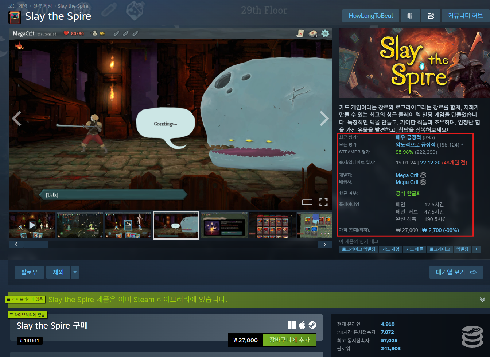

# KOsteamDB

Steam 상점 페이지에서 아래 확장 3가지의 출력물을 1개로 묶어 보여주는 크롬 확장.

- Steam HLTB (플레이타임) [링크](https://chromewebstore.google.com/detail/steam-hltb/cnfpnjgnkmonaeincdllnfeopmnngiin)
- SteamDB (최저가, 최근 업데이트) [링크](https://chromewebstore.google.com/detail/steamdb/kdbmhfkmnlmbkgbabkdealhhbfhlmmon)
- KOSTEAM (한글패치 정보) [링크](https://chromewebstore.google.com/detail/kosteam/cbcganplchikpgchgppklcblpjibhnnc)

| 적용 전 | 적용 후 |
|---|---|
|  |  |

## 설치

1. 위 확장 3가지 설치.
2. [Releases](https://github.com/kjk-l10n-ko/chrome-app-KOsteamDB/releases/latest)에서 `KOsteamDB-v*.zip`을 받아 폴더에 압축 해제.
3. Chrome에서 `chrome://extensions`를 열고 오른쪽 위 **개발자 모드** 켜기.
4. **압축해제된 확장 프로그램을 로드합니다**를 눌러 압축을 푼 폴더 선택.

업데이트: 새 zip을 같은 폴더에 덮어쓴 뒤 `chrome://extensions`에서 새로고침(⟳) 클릭.
